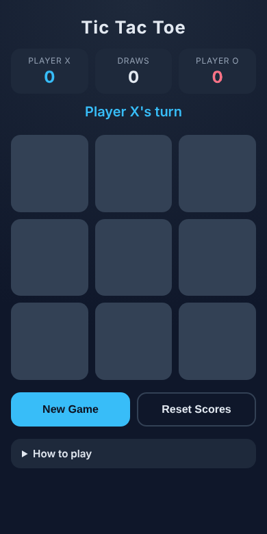
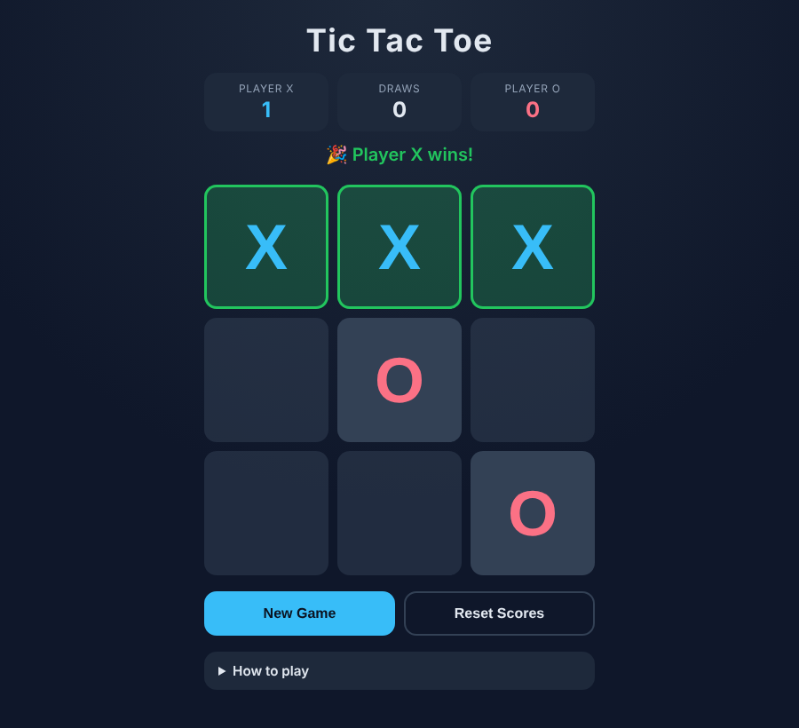
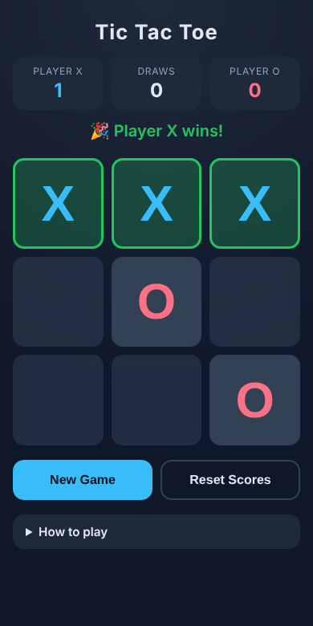
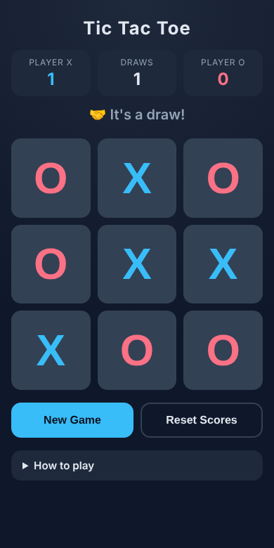

# Tic Tac Toe

A browser-playable, two-player Tic Tac Toe game written in plain HTML, CSS and JavaScript. No build step, no dependencies.



## Features

- 3×3 board for two players (X and O) taking turns on the same device
- Detects **win**, **loss** (the other player's win) and **draw**, and shows the outcome
- Winning line is highlighted; the board locks once the game ends
- **New Game** button (alternates who starts) and **Reset Scores** button
- Running scoreboard for Player X, Player O and draws
- Clear turn indicator ("Player X's turn") and a collapsible **How to play** section
- Responsive layout with large touch targets, works on phones and desktops
- Keyboard accessible, with ARIA labels and a live status region
- Game logic is separated from the UI and covered by unit tests

## Screenshots

| Desktop | Mobile (win) | Mobile (draw) |
| --- | --- | --- |
|  |  |  |

More: [start screen](screenshots/desktop-start.png), [mid-game](screenshots/desktop-midgame.png).

## Run it

Open `index.html` in any modern browser. That's it.

Or serve it locally:

```bash
npx serve .
# or
python3 -m http.server 8000
```

## How to play

1. Player X goes first. Players take turns clicking an empty square.
2. Get three of your marks in a row, column or diagonal to win.
3. If all nine squares are filled with no winner, it's a draw.
4. Press **New Game** to play again (scores are kept) or **Reset Scores** to start over.

## Project structure

```
├── index.html      # Markup
├── style.css       # Responsive styling
├── game.js         # Pure game logic (no DOM) - testable in Node
├── script.js       # UI rendering and event handling
├── game.test.js    # Unit tests for the game logic
└── screenshots/    # Screenshots and gameplay GIF
```

## Tests

Requires Node 18+:

```bash
npm test
```

The tests cover turn order, rejected moves on occupied squares, all 8 winning lines for both players, draws, and a win on the final move.

## Deploying to GitHub Pages

In the repository, go to **Settings → Pages**, choose the `main` branch and the root folder, and save. The game will be live at `https://<your-username>.github.io/<repo-name>/`.

## License

MIT
